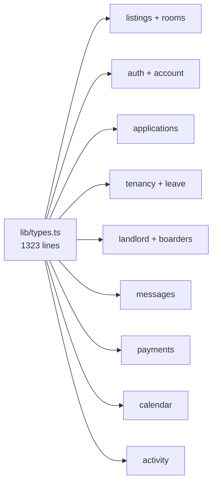
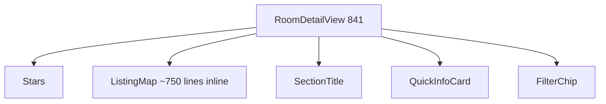

# Audit Report: Haven Space

Generated: 2026-10-26
Branch: `feat/apple-ui-restructure-qa-hardening`
Scope: full repository (`apps/web`, `workers/api`, `scripts`, `docs`), excluding generated and tool directories
Mode: **Full report**
Method: `find` + `wc -l` hybrid scans, directory/file counts, depth measurement, naming heuristics, import greps

---

## Executive Summary

The tree is structurally sound: naming is consistent, there are no non-exempt nesting violations, and package
boundaries (`apps/web`, `workers/api`, `scripts`, `docs`) are clean. Two real problems remain. First, **55 source
and test files exceed the 400-line threshold** — the frontend's `lib/types.ts` (1,323), the API's
`routes/payments.ts` (1,137) and `repositories/landlord-calendar.ts` (1,053) are the worst, and every one of them
mixes several unrelated concerns. Second, **documentation sprawl**: 46 markdown files across 4 locations, 21 of
them flat inside `docs/specs/`, plus an empty tracked `to-do-list.md` at the repo root and a stray untracked
`package-lock.json` in a Bun project.

Nothing here is a blocker for shipping; all of it is maintainability debt.

### Implementation status (2026-10-26)

- **Phase 1 — complete.** Dead root files removed, generated Wrangler types untracked, hooks renamed.
- **Phase 3 — complete.** Repositories consolidated, `apps/web/test` split, docs reorganised, fixtures moved.
- **Phase 2 — started.** `lib/types.ts` and `repositories/landlord-calendar.ts` are split (2.1, 2.3). The other
  24 source files and 21 test files in Phase 2 still need their split. See the tracker at the end.

---

## Severity Legend

- 🔴 **Warning** — should fix (measured against a threshold)
- 🟢 **Suggestion** — nice to improve (convention or hygiene)

---

## Metrics & Thresholds

| #   | Metric                     | Threshold                           | Result                                                                |
| --- | -------------------------- | ----------------------------------- | --------------------------------------------------------------------- |
| 1   | Folder file count          | > 30 files                          | 🔴 1 offender (`apps/web/test`, 31)                                   |
| 2   | File line count            | > 400 lines                         | 🔴 55 offenders (12 web src · 22 API src · 21 tests)                  |
| 3   | Nesting depth              | > 4 levels                          | 🟢 0 non-exempt (routes reach 5–6 by design — exempt per `AGENTS.md`) |
| 4   | Naming conventions         | mixed casing at one level           | 🟢 1 offender (`lib/useBoarderNav.ts` among 21 kebab-case siblings)   |
| 5   | Orphaned / misplaced files | purpose ≠ parent dir                | 🔴 5 offenders                                                        |
| 6   | Doc sprawl                 | > 5 `.md` not following a structure | 🔴 46 `.md`, 21 flat in `docs/specs/`                                 |
| 7   | Empty / dead directories   | empty or single-child               | 🟢 0 substantive (only `.wrangler`, `.tanstack` tool state)           |

Baseline data:

| Area                     | Files | Notes                                                                   |
| ------------------------ | ----- | ----------------------------------------------------------------------- |
| `apps/web/src`           | 222   | components 107, lib 21 files, routes 77                                 |
| `workers/api/src`        | 80    | repositories 21 + `payments/` 12 + `property-access/` 5 + `landlord/` 6 |
| `apps/web/test`          | 31    | flat                                                                    |
| `workers/api/test`       | 27    | flat                                                                    |
| `workers/api/migrations` | 24    | numbered 0001–0024                                                      |
| `scripts`                | 5     | `build/`, `setup/`, `tools/`                                            |
| `docs`                   | 38    | 36 `.md` + `qa/`, `specs/`, `superpowers/`                              |

Generated or vendored paths excluded: `node_modules/`, `.git/`, `dist/`, `.wrangler/`, `.tanstack/`, `.codegraph/`,
`.opencode/`, `.agents/`, `.omo/`, `apps/web/worker-configuration.d.ts` (16,538 lines, `wrangler types` output),
`apps/web/src/routeTree.gen.ts` (TanStack router output, intentionally committed).

---

## Issues Found

### Phase 1: Quick Cleanup

_Low effort, safe changes. No behaviour affected._

- [x] **Delete the empty tracked `to-do-list.md`** — 0 lines, at repo root, tracked by git. **Done:** removed from the index and disk.

  ```
  haven-space/
  ├── to-do-list.md        ← 0 bytes, tracked
  ├── README.md
  └── ...
  ```

- [x] **Remove the stray untracked `package-lock.json`** — the project uses Bun (`bun.lock` present at root
      _and_ `apps/web/bun.lock`, `workers/api`). An npm lockfile with no `npm` usage is runway for
      "which lockfile wins" bugs. `git ls-files` confirms it is untracked, so deletion is safe. **Done:** deleted.

- [x] **Stop tracking `apps/web/worker-configuration.d.ts`** (or move it out of lint/audit scope) — 16,538 lines
      of generated Wrangler types, committed. It dwarfs every real file and poisons any line-count metric.
      **Done:** added to `apps/web/.gitignore` and `.prettierignore`, removed from the index, and
      `apps/web/package.json`'s `typecheck` now runs `cf-typegen` first, because `tsc` genuinely needs the
      `cloudflare:workers` ambient module. `vite build` does **not** need it (verified by building with the file
      absent), so the Pages build is unaffected.

- [x] **Rename the three PascalCase hooks under `apps/web/src/lib/`** → `use-boarder-nav.ts`,
      `use-map-location.ts`, `use-unread-messages.ts` (kebab-case matches the other 19 files in `lib/`).

  ```
  apps/web/src/lib/
  ├── activity.ts
  ├── api/
  ├── auth-context.tsx
  ├── config.ts
  ├── dashboard-fixtures.ts        ← see Phase 3
  ├── maps.ts
  ├── nav.ts
  ├── useBoarderNav.ts             ← only kebab-case violation in the directory
  ├── useMapLocation.ts            ← same family, same problem
  ├── useUnreadMessages.ts         ← same family, same problem
  └── validation.ts
  ```

  **Done:** all three renamed with `git mv` and every import rewritten (20 + 7 + 3 files), including the
  source-path assertion in `apps/web/test/messages-inbox.test.tsx` and the two path tables in
  `docs/specs/find-a-room-map-modal-spec.md`.

- [x] **Move the two stray root docs into `docs/`** — obsolete: `to-do-list.md` is deleted above and no other
      stray root doc remains, so there is nothing left to move. `skills-lock.json` (tooling state), `README.md`,
      `AGENTS.md` and `LICENSE` stay at root legitimately.

---

### Phase 2: File Refactoring

_Medium effort — split oversized files, re-home misplaced files. Each item names the target module set and the
import changes required. Verify with `bun run cf:api:test`, `bun run web:test`, both typechecks and `web:build`
after each split (see the TDD note at the end)._

#### 2.1 `apps/web/src/lib/types.ts` — 1,323 lines (threshold 400) — ✅ done

Seven unrelated domains share one module: public listings, auth/account, applications, boarder tenancy, landlord
properties/boarders, messages, payments, calendar, activity. Every client module imports from it, which is why it
grew unchecked.



**After (proposed):**

```
apps/web/src/lib/types/
├── index.ts            ← barrel: `export * from './payments'` … keeps all 100+ existing imports working
├── listings.ts         ← RoomSummary, PublicProperty, ListingDetail, RoomDetail, SavedListings*
├── auth.ts             ← AuthUser, Login/Register/Me/Reset/Forgot/Verify/Profile*
├── applications.ts     ← ApplicationSummary/Detail/Input, AcceptedApplications*
├── tenancy.ts          ← TenancyResponse, LeaveRequestInput, onboarding status
├── landlord.ts         ← LandlordProperty, Invitations, Boarder rows, dashboard stats
├── messages.ts         ← Inbox row, Thread, Message
├── payments.ts         ← Charge, Submission, Tracker/TrackerStatus, BillingRules
├── calendar.ts         ← CalendarEvent, CalendarPayload, CalendarSummary
└── activity.ts         ← Activity feed rows
```

**Import changes:** none required if `index.ts` re-exports everything (`import type { X } from '../lib/types'`
still resolves). Recommended follow-up: point each `lib/api/<domain>.ts` at its own types module directly, leaving
the barrel only for components.

**Verification:** `bun run web:typecheck` must pass _before_ any import rewrite; then `web:test` + `web:build`.

---

#### 2.2 `workers/api/src/routes/payments.ts` — 1,137 lines

23 route registrations in one file: boarder charge views and submissions, landlord charges CRUD, record/cancel,
deposit resolution, submission verify/reject, CSV export, reporting, tracker, next-due-date and reminders.

**After (proposed):**

```
workers/api/src/routes/payments/
├── index.ts            ← mounts sub-routers on the same `/api/...` paths
├── boarder.ts          ← GET /api/boarder/payments, /:chargeId, POST submissions, POST proof
├── landlord-charges.ts ← GET list, POST charges, PATCH charge, cancel, GET charge, record, deposit-resolution
├── submissions.ts      ← POST verify, POST reject
├── billing.ts          ← POST tenancies/:id/billing, GET/PATCH billing-settings, next-due-date
├── reports.ts          ← GET report, export.csv, tracker, payment-history
└── reminders.ts        ← POST remind, POST charge proof
```

Shared helpers (`routeId`, `positiveNumber`, `isoDate`, `requireBoarder`, `landlordUser`) go to
`payments/helpers.ts`. `workers/api/src/index.ts` keeps importing `paymentsRoutes` from the same path — no change
at the mount site.

---

#### 2.3 `workers/api/src/repositories/landlord-calendar.ts` — 1,053 lines — ✅ done

Four independent event sources (charges, applications/leave, announcements, early departures) plus window math,
sorting, capping and summary building live together.

**After (proposed):**

```
workers/api/src/repositories/calendar/
├── types.ts              ← CalendarEvent, CalendarQuery, CalendarResult, families + event typing
├── windows.ts            ← manilaMidnight, toIsoTimestamp, isCalendarWindowValid, reference date, parseTypes
├── sources/
│   ├── charges.ts        ← charge_due / payment_received
│   ├── applications.ts   ← received / accepted / confirmed / move-in / leave_requested / move_out
│   ├── early-departures.ts
│   └── announcements.ts
├── aggregate.ts          ← sort, cap, family counts, money summary, attachOutstandingBalances
└── index.ts              ← listCalendarEvents, listCalendarEventSources (public surface unchanged)
```

`landlord-activity.ts` imports `listCalendarEventSources`; the barrel keeps that import valid.

---

#### 2.4 `workers/api/src/routes/admin.ts` — 924 lines

19 handlers spanning landlords, users, properties/rooms, applications, settings and the whole property-access
invitation flow.

**After (proposed):** `routes/admin/{index,landlords,users,properties,applications,settings,property-access}.ts`,
with `requireAdmin` / `parsePositiveInt` / `formatUserName` in `admin/helpers.ts`. The 19 `adminRoutes.*`
registrations at the bottom of the file stay together in `index.ts`, so route ordering is unchanged.

---

#### 2.5 `workers/api/src/routes/landlord/listings.ts` — 887 lines

Draft normalisation (`listingRooms`, `roomTypeForCapacity`, `roomTitle`), create, update with four
`updateListing*IfNeeded` helpers, and two multi-photo upload handlers.

**After (proposed):** `routes/landlord/listings/{index,create,update,photos}.ts` plus
`listings/drafts.ts` for the normalisers. Upload handlers are the largest single block (~160 lines) and depend on
UploadThing, so they justify their own module.

---

#### 2.6 `apps/web/src/components/rooms/RoomDetailView.tsx` — 841 lines



Measured correction: `ListingMap` is only ~20 lines (51–71); the baggage is the `RoomDetailView` body itself
(726 lines, 72–798). The split therefore extracts **sections of the component**, not the map.

**After (proposed):**

```
apps/web/src/components/rooms/detail/
├── RoomDetailView.tsx     ← composition + data wiring only
├── ListingMap.tsx         ← the map block (51–71, lazy-loadable)
├── RatingStars.tsx        ← Stars
├── InfoBlocks.tsx         ← SectionTitle, QuickInfoCard, FilterChip
└── sections/              ← the 726-line body's blocks, each taking props:
    ├── PhotoGallery.tsx
    ├── AmenityGrid.tsx
    ├── RoomPricing.tsx
    └── SimilarRooms.tsx
```

This one needs prop-shape decisions per section, so it is smaller per step than the API splits.

---

#### 2.7 `apps/web/src/components/rooms/FindARoomContent.tsx` — 718 lines

Search state, filter bar and a full property card renderer (`PropertyCard`, `Badge`, `amenityIcon`) in one file.

**After (proposed):** `rooms/find/{FindARoomContent.tsx,PropertyCard.tsx,Filters.tsx,AmenityIcon.ts}`
(`amenityIcon` is exported and has its own test — `test/amenity-icons.test.ts` — so it moves cleanly).

---

#### 2.8 Oversized tests

The worst test files are end-to-end suites for entire route groups, not single units:

| File                                             | Lines | Split into                                                          |
| ------------------------------------------------ | ----- | ------------------------------------------------------------------- |
| `workers/api/test/property-access.test.ts`       | 1,154 | `test/property-access/{invitations,grants,history,scoping}.test.ts` |
| `workers/api/test/landlord.test.ts`              | 1,123 | `test/landlord/{profile,listings,applications,dashboard}.test.ts`   |
| `workers/api/test/auth.test.ts`                  | 977   | `test/auth/{login,register,oauth,password-reset}.test.ts`           |
| `workers/api/test/account.test.ts`               | 969   | `test/account/{profile,preferences,signin-method}.test.ts`          |
| `workers/api/test/tenancy.test.ts`               | 962   | `test/tenancy/{submit,approve,leave-now,finalize}.test.ts`          |
| `workers/api/test/landlord-rooms.test.ts`        | 914   | `test/landlord-rooms/{crud,occupancy,photos}.test.ts`               |
| `workers/api/test/payments.test.ts`              | 882   | `test/payments/{charges,submissions,billing,reports}.test.ts`       |
| `workers/api/test/applications.test.ts`          | 824   | `test/applications/{boarder,landlord,status}.test.ts`               |
| `workers/api/test/payments-tracker.test.ts`      | 695   | `test/payments/{tracker,next-due}.test.ts`                          |
| `workers/api/test/landlord-verification.test.ts` | 649   | `test/landlord/{verification,documents}.test.ts`                    |
| `workers/api/test/landlord-boarders.test.ts`     | 572   | `test/boarders/{list,leave}.test.ts`                                |
| `workers/api/test/rooms.test.ts`                 | 587   | `test/rooms/{create,update,availability}.test.ts`                   |
| `workers/api/test/ai.test.ts`                    | 560   | `test/ai/{chat,limits}.test.ts`                                     |
| `workers/api/test/messages.test.ts`              | 528   | `test/messages/{threads,send,reads}.test.ts`                        |
| `workers/api/test/boarder.test.ts`               | 503   | `test/boarder/{profile,dashboard,applications}.test.ts`             |
| `workers/api/test/admin-dashboard.test.ts`       | 503   | `test/admin/{summary,lists}.test.ts`                                |
| `workers/api/test/landlord-calendar.test.ts`     | 442   | `test/calendar/{sources,payload,filters}.test.ts`                   |
| `apps/web/test/rooms-grid.test.tsx`              | 595   | `test/rooms/{grid,detail,find}.test.tsx`                            |
| `apps/web/test/maps.test.ts`                     | 540   | `test/maps/{geocode,bounds}.test.ts`                                |

Each split file needs its own `runMigrations` / `createEnv` copy **or** a shared `test/lib/tenant-fixture.ts`
(the latter is preferable — `workers/api/test/lib` already exists for shared helpers).

---

#### 2.9 Remaining offenders (>400 lines, one-line target each)

| File                                                    | Lines | Target                                                      |
| ------------------------------------------------------- | ----- | ----------------------------------------------------------- |
| `workers/api/src/repositories/tenancy.ts`               | 800   | `repositories/tenancy/{current,leave,approval,finalize}.ts` |
| `workers/api/src/routes/account.ts`                     | 715   | `routes/account/{profile,preferences,signin,sessions}.ts`   |
| `workers/api/src/repositories/messages.ts`              | 715   | `repositories/messages/{threads,messages,reads}.ts`         |
| `apps/web/src/lib/payments.ts`                          | 686   | `lib/payments/{format,status,tracker,summary}.ts`           |
| `workers/api/src/routes/auth/google.ts`                 | 626   | `routes/auth/google/{start,callback,link}.ts`               |
| `workers/api/src/repositories/listings.ts`              | 625   | `repositories/listings/{create,update,queries}.ts`          |
| `workers/api/src/repositories/account.ts`               | 615   | `repositories/account/{profile,preferences,credentials}.ts` |
| `apps/web/src/routes/landlord/listings/$id/edit.tsx`    | 611   | extract form sections into `components/listings/edit/*`     |
| `workers/api/src/repositories/payments/tracker.ts`      | 610   | `payments/tracker/{rows,status,sort}.ts`                    |
| `workers/api/src/routes/landlord/rooms.ts`              | 599   | `landlord/rooms/{crud,occupancy,photos}.ts`                 |
| `workers/api/src/routes/messages.ts`                    | 593   | `routes/messages/{threads,messages,reads}.ts`               |
| `workers/api/src/routes/ai.ts`                          | 577   | split chat vs. moderation handlers                          |
| `apps/web/src/components/messages/MessageThread.tsx`    | 537   | extract composer + bubble list                              |
| `workers/api/src/repositories/announcements.ts`         | 521   | `announcements/{crud,targets,views}.ts`                     |
| `workers/api/src/repositories/admin-dashboard.ts`       | 565   | `admin-dashboard/{kpis,series}.ts`                          |
| `apps/web/src/routes/landlord/listings/create.tsx`      | 464   | extract form sections into `components/listings/create/*`   |
| `apps/web/test/payments-monitor-table.test.tsx`         | 456   | split table vs drawer assertions                            |
| `apps/web/src/components/admin/PropertyAccessTab.tsx`   | 448   | `components/admin/property-access/{tab,invite,table}.tsx`   |
| `workers/api/src/routes/rooms.ts`                       | 444   | split room CRUD vs occupancy                                |
| `apps/web/src/routes/landlord/boarders.tsx`             | 444   | extract Add/Edit modal + action cell                        |
| `apps/web/src/lib/api/landlord.ts`                      | 441   | `lib/api/landlord/{properties,boarders,announcements}.ts`   |
| `apps/web/src/routes/boarder/find-a-room/$id/apply.tsx` | 439   | extract form into a component                               |
| `workers/api/src/repositories/landlord-verification.ts` | 438   | split document slots vs review                              |
| `workers/api/test/e2e-flow.test.ts`                     | 434   | keep (single intentional journey)                           |
| `workers/api/src/repositories/landlord-rooms.ts`        | 424   | split queries vs mutations                                  |
| `workers/api/src/routes/applications.ts`                | 410   | split boarder vs landlord handlers                          |
| `workers/api/src/repositories/payments/ledger.ts`       | 410   | split charge reads vs snapshots                             |
| `workers/api/src/repositories/users.ts`                 | 403   | split identity vs status                                    |
| `apps/web/src/routes/boarder/tenancy.tsx`               | 407   | extract leave modals into `components/tenancy/*`            |

---

### Phase 3: Structural Refactoring

_Higher effort — reorganize folders, consolidate parallel structures, tame documentation._

- [x] **Resolve the file + folder collisions in `workers/api/src/repositories/`**
      **Done:** `property-access.ts` → `property-access/index.ts`; the `landlord/` folder → `landlord-properties/`
      with its barrel folded in as `landlord-properties/index.ts`. The barrel keeps every import
      (`'…/property-access'`, `'…/landlord-properties'`) resolving, and `admin-dashboard.ts` now points at
      `./landlord-properties/properties-photos.js`. Flat `landlord-*.ts` domain files stay flat — the collision
      that mattered was the file/folder shadowing, not the prefix.

  ```
  workers/api/src/repositories/
  ├── landlord/                  ← folder
  ├── landlord-activity.ts       ← five flat landlord-* files beside it
  ├── landlord-boarders.ts
  ├── landlord-calendar.ts
  ├── landlord-dashboard.ts
  ├── landlord-properties.ts
  ├── landlord-rooms.ts
  ├── landlord-verification.ts
  ├── property-access/           ← folder
  └── property-access.ts         ← same name as the folder, ambiguous import target
  ```

  Two competing conventions (`landlord-*.ts` vs `landlord/`) for one domain, and `property-access.ts` shadowing
  `property-access/`. Consolidate on the folder form: `repositories/landlord/{properties,rooms,boarders,calendar,
dashboard,activity,verification}.ts`, and fold `property-access.ts` into `property-access/index.ts`.

- [x] **Split `apps/web/test/` (31 files, threshold 30) by kind**
      **Done:** `test/components/` (10), `test/routes/` (9), `test/lib/` (11), `setup.ts` stays at the root so the
      `--preload ./test/setup.ts` flag is untouched. Relative depths bumped to `../../src/…` and every
      `join(import.meta.dir, '..')` root recalculated.

  ```
  apps/web/test/
  ├── setup.ts
  ├── components/    ← modal, button-variants, components, toast-component, feature-gate, rooms-grid
  ├── routes/        ← landlord-*, boarder-*, payments-*, create-listing-*, edit-listing-*, auth-layout
  ├── lib/           ← api, config, routes, validation, maps, oauth, toast, payments, boarder-nav
  └── fixtures/      ← shared event()/renderInApp helpers currently duplicated per file
  ```

  This both clears the folder threshold and kills the helper duplication noted in 2.8.

- [x] **Consolidate documentation (46 `.md`, 21 flat in `docs/specs/`)**
      **Done:** `docs/{README,guides,reference,specs/{payments,landlord,tenancy,boarder,messages,admin,platform},qa/{specs,reports},plans,assets}`,
      with `docs/specs/README.md` indexing every spec. Stale paths inside the specs were rewritten
      (`docs/qa/specs/…`, `docs/reference/schema.md`, `docs/plans/…`).

  Current shape:

  ```
  docs/
  ├── COMMIT_GUIDELINES.md
  ├── DESIGN.md
  ├── MANUAL.md
  ├── MODAL.md                  ← design/UX doc living at docs root
  ├── guest-ai-limit-spec.md    ← feature spec outside specs/
  ├── toast-system-spec.md      ← feature spec outside specs/
  ├── assets/screenshot1.png    ← generic name, no index
  ├── qa/{qa-spec.md, qa-spec-audit.md, report.md, qa-full-system-review-spec.md}
  ├── specs/                    ← 21 flat specs, no index
  │   ├── admin-apple-ui-restructure-spec.md
  │   ├── approve-leave-request-spec.md
  │   ├── … 18 more
  │   ├── google-oauth.md       ← reference, not a spec
  │   └── schema.md             ← reference, not a spec
  └── superpowers/plans/{5 dated plans}
  ```

  Proposed:

  ```
  docs/
  ├── README.md                 ← index: what lives where
  ├── guides/{COMMIT_GUIDELINES,DESIGN,MANUAL,MODAL}.md
  ├── reference/{schema.md,google-oauth.md,style-flatline-illustration.json}
  ├── specs/
  │   ├── README.md             ← table: spec → status → surface
  │   ├── payments/             ← payments-*, payments-tracker-*, payments-shell-*
  │   ├── landlord/             ← landlord-*, admin-apple-ui-*
  │   ├── boarder/              ← leave-now, find-a-room-map-modal, approve-leave-request
  │   ├── tenancy/              ← create-listing-*, edit-listing-property-info
  │   └── platform/             ← settings-signin-method, guest-ai-limit, toast-system
  ├── qa/{index.md, reports/, specs/}
  └── plans/                    ← was superpowers/plans (drop the vendor-style nesting)
  ```

  Rename the one inconsistent doc (`google-oauth.md` → `google-oauth-spec.md` if it is a spec, otherwise
  `reference/google-oauth.md`) so the `*-spec.md` suffix means one thing.

- [x] **Move `apps/web/src/lib/dashboard-fixtures.ts` out of production `lib/`**
      **Done:** moved to `lib/fixtures/dashboard.ts`, both imports updated. The fixture data itself is still
      sample data feeding the dashboard — naming it `fixtures/` makes that explicit rather than pretending it
      is production lib code.
      It exports hardcoded `maintenanceRequests` and `revenueTrend` and is imported by the live dashboard route
      (`apps/web/src/routes/landlord/index.tsx:22`) and `RevenueTrendCard`. Fixture data in `lib/` reads as
      production code. Either move it to `lib/fixtures/dashboard.ts` with a `TODO` naming the API it awaits, or
      replace it with the real endpoint — leaving it where it is invites shipping sample data.

---

## Before / After Summary

```
BEFORE                                   AFTER (targets)
──────                                   ───────────────
apps/web/src/lib/                        apps/web/src/lib/
├── types.ts            1,323 lines      ├── types/
├── payments.ts           686 lines      │   ├── index.ts (barrel)
├── api/landlord.ts       441 lines      │   ├── payments.ts
└── dashboard-fixtures.ts               │   ├── calendar.ts
                                         │   └── … 7 domain modules
                                         ├── payments/
                                         └── fixtures/dashboard.ts

workers/api/src/routes/                  workers/api/src/routes/
├── payments.ts         1,137 lines      ├── payments/{index,boarder,landlord-charges,…}.ts
├── admin.ts              924 lines      ├── admin/{index,landlords,users,…}.ts
├── landlord/listings.ts  887 lines      └── landlord/listings/{index,create,update,photos}.ts
└── messages.ts           593 lines

workers/api/src/repositories/            workers/api/src/repositories/
├── landlord-calendar.ts 1,053 lines     ├── calendar/{types,windows,sources/,aggregate}.ts
├── tenancy.ts             800 lines     ├── tenancy/{current,leave,approval,finalize}.ts
├── property-access.ts +  property-access/  → merged into property-access/
└── landlord-*.ts (5) + landlord/       → merged into landlord/
```

---

## Refactoring Progress

Use this checklist to track completion. Mark `[x]` when a task is done:

**Phase 1 — Quick Cleanup:** `[x]` 5 of 5 complete (2026-10-26)
**Phase 2 — File Refactoring:** `[~]` in progress (2.1 `lib/types.ts` → 9 modules behind a barrel;
2.3 `landlord-calendar.ts` → `repositories/calendar/{types,helpers,charges,applications,early-departures,announcements,index}.ts`
behind a barrel). Also done 2026-11-03: 2.2 `routes/payments/`, 2.4 `routes/admin/`, 2.5
`routes/landlord/listings/`, and the `repositories/tenancy/`, `repositories/users/`,
`repositories/payments/ledger/`, `repositories/landlord-rooms/`,
`repositories/landlord-verification/` and `routes/applications/` splits. Remaining: 2.6–2.9 —
the web components, the oversized test suites, and the API modules still over 400 lines.
**Phase 3 — Structural:** `[x]` 4 of 4 complete (2026-10-26)

> Update this checklist as you implement fixes. When every box is ticked, the codebase is inside its thresholds.

---

## Execution Notes

- **Order:** Phase 1 first (removes noise from every later measurement), then 2.1 (types barrel unlocks cleaner
  imports for the rest), then the API route/repository splits, then tests, then Phase 3 folder moves last — moves
  immediately invalidate import paths and are cheapest once files are already small.
- **TDD warning:** before any split that cuts code into new modules, lock the current behaviour with the existing
  suites. This repo already has 361 API tests and 325 web tests; run both before and after each split rather than
  trusting a green typecheck.
- **Per-split verification:** `bun run cf:api:typecheck`, `bun run cf:api:test`, `bun run web:typecheck`,
  `bun run web:test`, `bun run web:build`. A split that only typechecks is not verified.
- **Exemptions honoured:** `apps/web/src/routes/` nesting (TanStack file-router, up to 8 levels) is intentional per
  `AGENTS.md` and is **not** reported as a depth issue.
- **After splitting, review each extracted module with the `code-design` skill** — line count is the trigger, not
  the goal; the extracted functions still need single responsibility, guard clauses and explicit side effects.

---

## Next Step

Run the **implement-folder-architecture** skill with this report (`haven-space-audit.md`) to execute the migration
incrementally, phase by phase.
